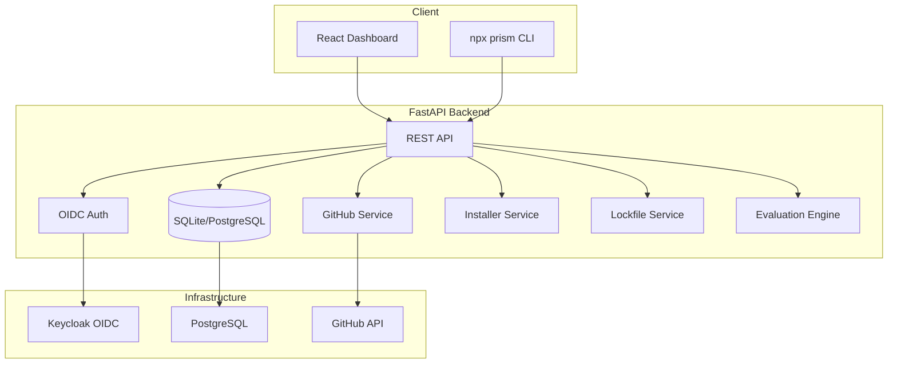

# Prism Workbench — Alan Vo

> Work in progress. This checkpoint may be incomplete or fail tests. See PLAN.md and STATUS.md before use.


**Prism Workbench | Alan Vo | AI & Machine Learning**

An open agent skills management tool for discovering, installing, and managing AI agent skills from GitHub repositories. Provides a CLI (`npx prism`) and web dashboard for reproducible skill dependency management with `skills-lock.json` (similar to `npm ci`).

## The Problem

AI agents (Claude Code, Cursor, Codex, Windsurf, etc.) increasingly rely on "skills" — reusable prompt templates, tools, and workflows stored in GitHub repositories. However, managing these skills across teams and CI environments is fragmented:

- No standard way to restore skills from a lockfile (`npm ci` equivalent)
- Large repositories (e.g., `vercel/turborepo` at 770MB) cause clone timeouts
- Stale cached content on skill registries (skills.sh issues #780, #2192)
- No search/discovery across skill repositories
- Windows path issues for global installs (issue #840)

## Implemented AI/ML Approach

Prism Workbench implements a **reproducible skill dependency manager** with:

1. **Sparse Git checkout** — Uses `--filter=blob:none` with sparse checkout to download only skill directories, not entire repositories
2. **Content-addressable storage** — SHA-256 hashes of skill folders enable exact verification and idempotent installs
3. **Lockfile-first workflow** — `skills-lock.json` is the single source of truth; `npx prism install` restores from it
4. **AI/ML evaluation engine** (planned) — Automated skill quality scoring, security analysis, and reproducible baselines

## Target Users

- **Agent developers** building reusable skills for AI agents
- **Engineering teams** standardizing agent tooling across projects
- **CI/CD pipelines** needing reproducible skill installation
- **Skill authors** publishing to GitHub who want reliable distribution

## Features

### Core (Implemented)
- ✅ FastAPI backend with SQLite/PostgreSQL persistence
- ✅ React + TypeScript + Vite frontend dashboard
- ✅ OIDC authentication via Keycloak (with SAML broker support)
- ✅ Backend-managed sessions with HttpOnly cookies + CSRF protection
- ✅ Docker Compose with Keycloak, PostgreSQL, backend, frontend
- ✅ Health/readiness endpoints for orchestration

### Skill Management (In Progress)
- 🔄 GitHub repository discovery with sparse checkout
- 🔄 SKILL.md parsing and metadata extraction
- 🔄 Skill installation to agent directories (.claude, .cursor, .agents, .codex)
- 🔄 `skills-lock.json` management with hash verification
- 🔄 `npx prism install` / `ci` for lockfile restoration
- 🔄 Search and filtering by name, owner, tags
- 🔄 Update command with hash comparison

### AI/ML Evaluation (Planned)
- 📋 Automated skill quality scoring (completeness, documentation, tests)
- 📋 Security analysis (advisory, labeled, grounded in actual content)
- 📋 Reproducible evaluation command with baseline metrics
- 📋 Results stored and displayed in dashboard

## Architecture



## Quick Start

### Prerequisites
- Docker and Docker Compose
- Node.js 24+ (for CLI development)
- Python 3.12+ (for backend development)

### Development Setup

```bash
# Clone and enter
git clone https://github.com/ALANDVO/prism-workbench-alan-vo
cd prism-workbench-alan-vo

# Copy environment template
cp .env.example .env
# Edit .env with your settings (especially SECRET_KEY, GITHUB_TOKEN)

# Start all services
docker compose up -d

# Access points:
# Frontend: http://localhost:3000
# Backend API: http://localhost:8000
# Keycloak Admin: http://localhost:8080 (admin / admin_dev_password)
# API Docs: http://localhost:8000/docs
```

### Local Development (without Docker)

**Backend:**
```bash
cd backend
python -m venv .venv
.venv/bin/pip install -r requirements.txt
.venv/bin/python -m pytest tests/ -v
.venv/bin/uvicorn app.main:app --reload --host 127.0.0.1 --port 8000
```

**Frontend:**
```bash
cd frontend
npm install
npm run dev
```

### Demo Mode
Set `DEMO_MODE=true` in `.env` to enable local demo login at `/api/auth/demo-login` (creates an operator account). **Demo mode is refused in production** (when `DEBUG=false` and `DEMO_MODE=false`).

## Configuration

| Variable | Required | Description |
|----------|----------|-------------|
| `SECRET_KEY` | Yes | 32+ char secret for JWT/sessions |
| `DATABASE_URL` | Yes | SQLAlchemy async URL (SQLite or PostgreSQL) |
| `OIDC_ISSUER_URL` | If OIDC enabled | Keycloak realm URL |
| `OIDC_CLIENT_ID` | If OIDC enabled | Keycloak client ID |
| `OIDC_CLIENT_SECRET` | If OIDC enabled | Keycloak client secret |
| `OIDC_REDIRECT_URI` | If OIDC enabled | Frontend callback URL |
| `GITHUB_TOKEN` | No | GitHub PAT for higher rate limits |
| `DEMO_MODE` | No | Enable demo login (dev only) |
| `LLM_API_KEY` | No | For AI/ML evaluation engine |

### Keycloak SAML Broker Setup
Keycloak supports upstream SAML IdPs through identity brokering. To configure:
1. Log into Keycloak Admin Console (`http://localhost:8080/admin`)
2. Select the `prism` realm
3. Go to **Identity Providers** → **Add provider** → **SAML v2.0**
4. Configure your SAML IdP metadata (entity ID, SSO URL, certificates)
5. Map SAML attributes to Keycloak user attributes
6. Enable **First Login Flow** to link accounts

## API Reference

### Health
- `GET /api/health` — Basic health check
- `GET /api/health/db` — Database connectivity
- `GET /api/health/ready` — Readiness probe

### Authentication
- `GET /api/auth/login` — Initiate OIDC login
- `GET /api/auth/callback` — OIDC callback
- `POST /api/auth/logout` — Logout
- `GET /api/auth/me` — Current user info
- `POST /api/auth/refresh` — Refresh access token
- `GET /api/auth/demo-login` — Demo login (dev only)

### Skills (Planned)
- `GET /api/skills` — List skills (paginated, filterable)
- `GET /api/skills/{id}` — Skill details
- `POST /api/skills/discover` — Discover skills from GitHub repo
- `GET /api/skills/search` — Search skills

### Installations (Planned)
- `GET /api/installations` — List user installations
- `POST /api/installations` — Install skill
- `DELETE /api/installations/{id}` — Uninstall skill
- `POST /api/installations/restore` — Restore from lockfile (`npx prism install`)
- `POST /api/installations/ci` — Strict restore (`npx prism ci`)

### Updates (Planned)
- `POST /api/updates/check` — Check for skill updates
- `POST /api/updates/apply` — Apply updates

## Security

### Implemented
- OIDC authorization code flow with PKCE
- State + nonce validation
- HttpOnly, SameSite=Lax session cookies
- CSRF protection via double-submit cookie pattern
- Role-based access control (viewer, operator, admin)
- No tokens in localStorage (access tokens in memory only)
- Redacted error messages (no credential leakage)
- Input validation via Pydantic models
- SQL injection prevention via SQLAlchemy ORM

### Limitations
- Demo mode creates predictable credentials (disabled in production)
- SQLite not suitable for concurrent production workloads
- Self-signed certificates not configured (use reverse proxy for TLS)
- Rate limiting not implemented (add via reverse proxy)
- Audit logging minimal (expand for compliance)

### Provider Configuration

| Provider | Adapter | Base URL | Notes |
|----------|---------|----------|-------|
| OpenAI | OpenAI-compatible | `https://api.openai.com/v1` | Default |
| Anthropic | Anthropic messages | `https://api.anthropic.com` | Requires `anthropic` SDK |
| Gemini | Gemini generateContent | `https://generativelanguage.googleapis.com` | Requires `google-generativeai` |
| Ollama | OpenAI-compatible | `http://localhost:11434/v1` | Local models |
| LiteLLM | OpenAI-compatible | Configurable | Multi-provider proxy |
| OpenRouter | OpenAI-compatible | `https://openrouter.ai/api/v1` | Model marketplace |

Keys only server-side. Endpoint from operator config only. Bounded timeouts, redacted errors. No hardcoded endpoints or build-agent models.

## Deployment

### TLS Reverse Proxy (Required for Production)
```nginx
# Example nginx config
server {
    listen 443 ssl http2;
    server_name prism.example.com;

    ssl_certificate /etc/letsencrypt/live/prism.example.com/fullchain.pem;
    ssl_certificate_key /etc/letsencrypt/live/prism.example.com/privkey.pem;

    location / {
        proxy_pass http://127.0.0.1:3000;
        proxy_set_header Host $host;
        proxy_set_header X-Real-IP $remote_addr;
        proxy_set_header X-Forwarded-For $proxy_add_x_forwarded_for;
        proxy_set_header X-Forwarded-Proto $scheme;
    }

    location /api/ {
        proxy_pass http://127.0.0.1:8000;
        proxy_set_header Host $host;
        proxy_set_header X-Real-IP $remote_addr;
        proxy_set_header X-Forwarded-For $proxy_add_x_forwarded_for;
        proxy_set_header X-Forwarded-Proto $scheme;
    }
}
```

### Backup/Restore
```bash
# Backup database
docker compose exec postgres pg_dump -U prism prism > backup.sql

# Restore database
docker compose exec -T postgres psql -U prism prism < backup.sql

# Backup skill data volume
docker run --rm -v prism_data:/data -v $(pwd):/backup alpine tar czf /backup/prism_data.tar.gz -C /data .
```

### IdP Enrollment
1. Configure SAML/OIDC identity provider in Keycloak
2. Map attributes (email, username, roles)
3. Test with a pilot group
4. Roll out to organization

## Development

### Running Tests
```bash
# Backend
cd backend
.venv/bin/pip install -r requirements.txt
PYTHONPATH=. .venv/bin/python -m pytest tests/ -v

# Frontend
cd frontend
npm install
npm run typecheck
npm run build
npm test
```

### Code Quality
```bash
# Backend
cd backend
.venv/bin/pip install ruff mypy
.venv/bin/ruff check app/
.venv/bin/mypy app/

# Frontend
cd frontend
npm run lint
npm run typecheck
```

## AI/ML Evaluation

This section will document the reproducible evaluation framework for skill quality.

### Reproducible Command
```bash
# To be implemented
npx prism evaluate --baseline --output eval-results.json
```

### Data Provenance
- Skills sourced from public GitHub repositories
- Evaluation runs against committed `skills-lock.json` snapshots
- Baseline established on initial skill corpus

### Measured Results
*To be populated after evaluation engine implementation*

### Failure Cases
*To be documented during evaluation engine development*

## License

MIT License — see [LICENSE](LICENSE) for details.

## Author

**Alan Vo** — alanvo@gmail.com

---

*Prism Workbench is an independent implementation inspired by the `vercel-labs/skills` ecosystem. Not affiliated with Vercel.*